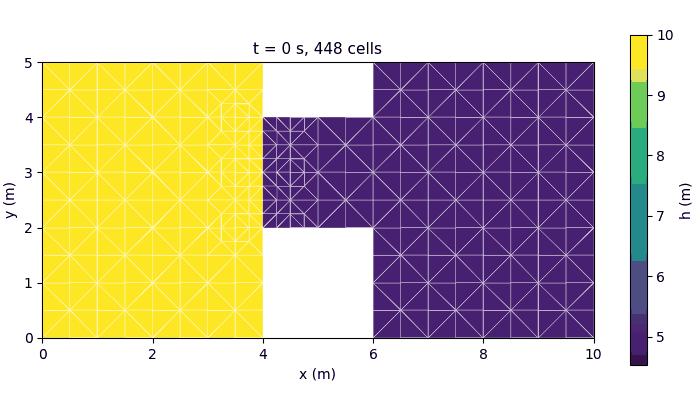
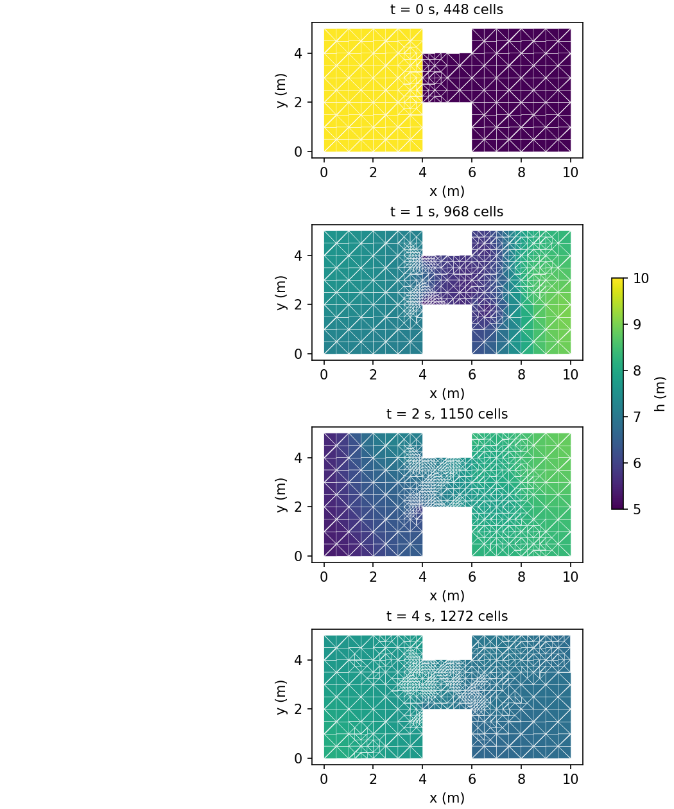
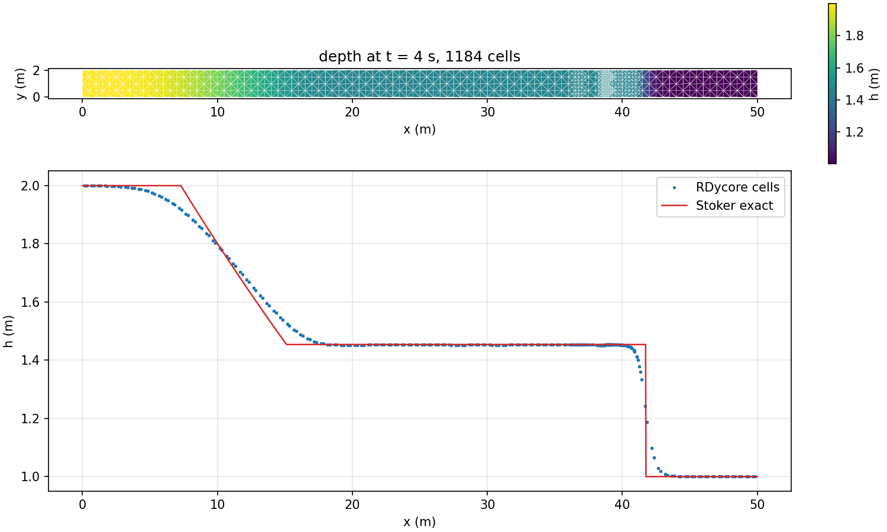
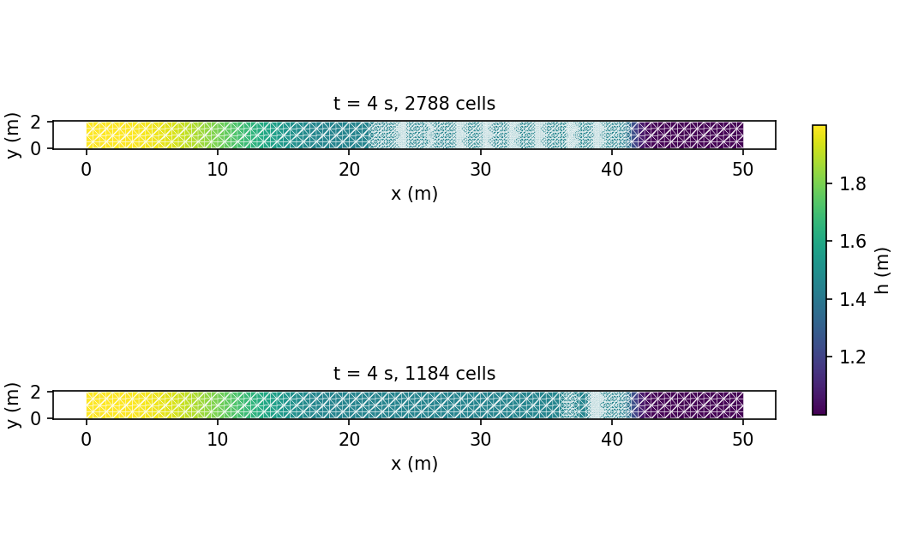

# Overview

Two small cases that exercise adaptive mesh refinement end to end: the mesh is
refined from the solution itself, coarsened again where the flow has moved on,
and the result is checked against an exact solution. Both run in seconds on a
laptop and are part of `ctest`.

AMR runs under the `rdycore_amr` driver, and the mesh must be simplicial,
because the adapt refines by simplex bisection:

```
rdycore_amr <case>.yaml \
  -dm_adaptor cellrefiner \
  -dm_plex_transform_type refine_sbr \
  -dm_plex_transform_label_match_strata \
  -refine_criterion jump -refine_at_start -refine_allow_coarsening
```

`rdycore_amr -help` lists the rest. The meshes are written by
[`share/meshes/make_swe_tri_mesh.py`](../../../../share/meshes/make_swe_tri_mesh.py),
which needs no gmsh, and the figures below by
[`tools/postprocessing/amr_dam_break.py`](../../../../tools/postprocessing/amr_dam_break.py)
(`error`, `plot`, `panels` and `movie`).

## What drives the refinement

`-refine_criterion jump` marks cells from the state: the indicator of a cell is
the largest jump in water-surface elevation `h + z` across its faces. Free
surface rather than depth, so still water over a varying bed indicates nothing,
and a dam is marked at step 0 before anything moves.

Which cells that selects is a PETSc `VecTagger` owned by the `DMAdaptor`, so it
is a runtime choice; RDycore only sets the defaults, and anything given on the
command line wins:

| option | effect |
| --- | --- |
| `-rdy_amr_refine_vec_tagger_type relative -rdy_amr_refine_vec_tagger_box 0.5,1` | at least half the largest jump (default) |
| `-rdy_amr_refine_vec_tagger_type cdf -rdy_amr_refine_vec_tagger_box 0.95,1` | the worst 5% of cells |
| `-rdy_amr_coarsen_vec_tagger_box 0,0.05` | coarsen the quietest 5% (needs `-refine_allow_coarsening`) |
| `-rdy_amr_buffer_layers <n>` | also refine `n` cell layers around each marked cell |
| `-rdy_amr_max_levels <n>` | deepest level below the starting mesh (default 3) |

The default is scale-free on purpose. An absolute threshold disables itself:
halving a cell halves the jump across its faces, so a front that was over the
threshold falls under it after one adapt and the mesh stops following it.

## 2D dam break through a breach

`driver/tests/amr/dam_break_amr.yaml`: a 10 m x 5 m basin with a dam across the
middle pierced by a central breach, 10 m of water upstream and 5 m downstream,
352 triangles to start.



The mesh is refined along the dam before the first step, follows the jet
through the breach and the front spreading downstream, and coarsens behind
them: 448 cells at the start, 968 at t = 1 s, 1150 at t = 2 s, 1272 at t = 4 s,
with the count falling again wherever the flow has settled.
The same four instants, side by side:



## 1D dam break on a 2D mesh

`driver/tests/amr/channel_wave_amr.yaml`: a 50 m x 2 m channel, frictionless,
2 m of water over 1 m, 800 triangles, stopping before either wave reaches an
end wall. Nothing varies across the channel, so this is a wet-bed Riemann
problem run on a 2D mesh, and it has an exact solution -- Stoker's -- which
`amr_dam_break.py error` evaluates independently and compares against.



The computed star depth, the shock position and the rarefaction fan all sit on
the exact solution; the area-weighted L1 depth error is 0.0144 m at t = 4 s on
1184 cells. L1 rather than Linf because the solution has a shock, where a
first-order scheme's pointwise error does not converge.

## Why coarsening matters

Both meshes at t = 4 s, refined on the same criterion; only the lower one is
allowed to coarsen.



Refining alone (top, 2788 cells) spends the mesh on the wake: a cell refined at
any adapt stays refined, so the fine region becomes the union of every past
position of the wave, where the solution is flat and the error is near zero.
Measured, 99.6% of its refined cells sit there. Rebuilding the mesh from the
base mesh at every adapt (bottom, 1184 cells) puts them on the shock instead,
for the same error at well under half the cells.

## Conservation and the gates

`-refine_check_volume` reports the water volume `sum(h * area)` across every
adapt. The transfer between the two meshes is area-weighted
(`U_new = sum |new ^ old| U_old / |new|`), which preserves that sum exactly, so
the only change is the order of the summation: measured at or below 8.2e-15
relative over every adapt of both cases, on 1 and 3 ranks.

The `ctest` suite runs both cases on 1 and 3 ranks with and without coarsening,
and `amr_off_is_bitwise` asserts that running the adapt machinery with a tagger
that marks nothing reproduces the plain `rdycore` driver byte for byte.
